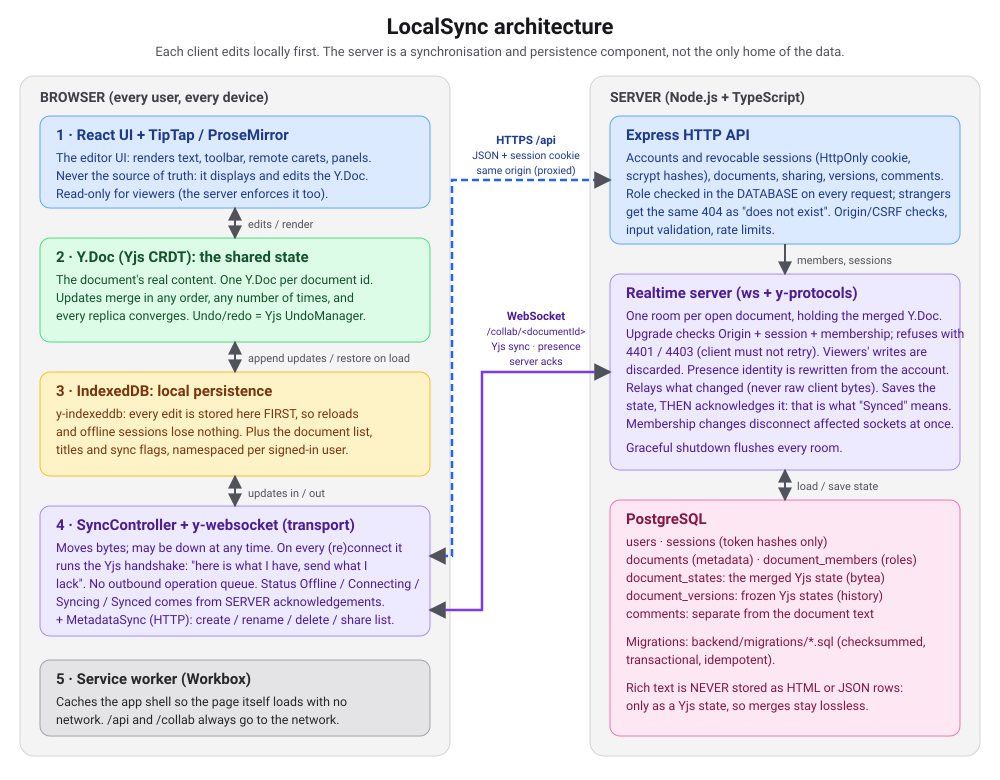
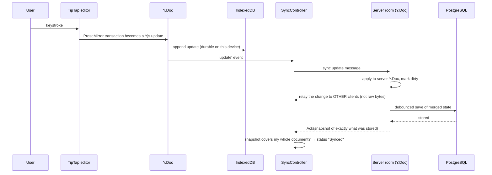
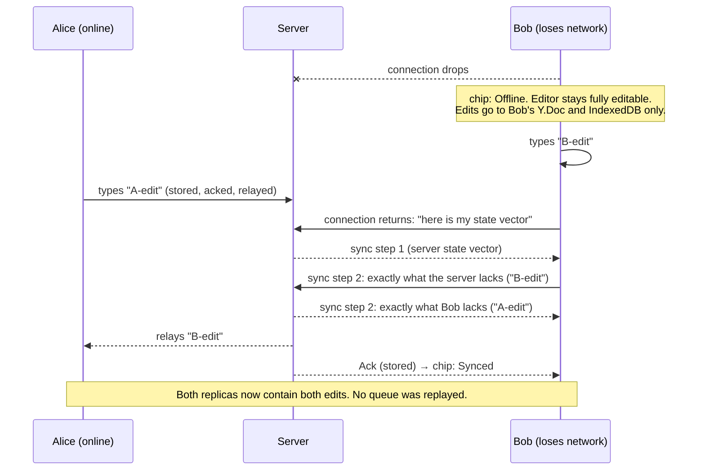

# Architecture

## The four things that are easy to confuse

The most useful way to read this codebase is to keep four ideas apart. Every bug in a collaborative editor comes from mixing two of them.

| Layer | In this project | Responsibility | What it is **not** |
|---|---|---|---|
| **Editor UI** | React + TipTap / ProseMirror | Draw the text, handle typing and the toolbar, draw remote carets | The source of truth. It is a *view* of the `Y.Doc` |
| **Shared state** | `Y.Doc` (Yjs) | Hold the real content of a document as a CRDT | A network thing. It works with no network at all |
| **Merge semantics** | Yjs's algorithm | Guarantee that every replica that has seen the same updates shows the same text, whatever the order | Something the server decides. There is no central merge authority |
| **Transport** | `y-websocket` provider / `SyncController` ↔ `ws` + `y-protocols` on the server | Carry bytes between replicas; reconnect; report status | A source of truth or a queue. It can be down for days and nothing is lost |

IndexedDB is not a fifth idea: it is simply *another place a replica's updates are written*, so a replica survives a reload.

## Components and responsibilities

### Browser

| Component | Files | Responsibility |
|---|---|---|
| Editor | `frontend/src/editor/*` | TipTap with `StarterKit` (ProseMirror history **disabled**, Yjs owns undo), `Collaboration` bound to the `Y.Doc`, `CollaborationCaret` for remote cursors, toolbar, link dialog |
| Local document | `lib/localDocument.ts`, `hooks/useLocalDocument.ts` | Open one `Y.Doc` per document id with `y-indexeddb`. The editor mounts only after **every stored update has been loaded** (`whenSynced`), so an empty first render can never be mistaken for an empty document. Detects open failures and write failures and shows them |
| Metadata store | `lib/idbDocumentStore.ts` | Document list, titles, roles, "not yet sent" flags, per-user IndexedDB namespace |
| Sync controller | `shared/src/syncController.ts` | Owns the WebSocket provider for one document. Computes the honest status. Connects only *after* local restore |
| Metadata sync | `lib/metadataSync.ts` | Reconciles the document list with the server: uploads documents created offline, pushes renames and deletions, pulls shared documents |
| Auth | `hooks/auth-context.tsx`, `lib/authCache.ts` | Sign-in state; remembers *who* was signed in (not a token) so the app opens offline |
| Service worker | `vite-plugin-pwa` (Workbox) | Cache the app shell (HTML / JS / CSS) so a reload with no network still loads. `/api` and `/collab` are never cached |

### Server

| Component | Files | Responsibility |
|---|---|---|
| HTTP API | `backend/src/routes/*`, `middleware/*`, `services/*` | Accounts, sessions, documents, sharing, versions, comments. Validates all input, authorizes from the database on every request |
| Realtime server | `backend/src/realtime/*` | Accepts WebSocket upgrades, authorizes them, keeps one **room** per open document, merges and relays updates, enforces read-only, sanitises presence, persists, acknowledges |
| Persistence | `realtime/pgPersistence.ts` | Loads and saves each room's merged Yjs state in `document_states`; adds automatic version checkpoints in the same transaction |
| PostgreSQL | `backend/migrations/*` | Durable server-side records: [schema](database.md) |

## Data flows

### 1. Typing (online)

The status chip says **Synced** only at the last step. Before it, the editor is already correct and the text is already on this device ("Saved on this device"); the chip says **Syncing**.

### 2. Editing while offline, then reconnecting

(The diagram serialises the handshake for readability; in reality both directions run concurrently: each side sends its state vector and replies with whatever the other lacks.)

There is **no operation queue** to get out of order, drop, or duplicate. The handshake compares *what each side has* (state vectors) rather than *what each side did*, which is why re-connecting ten times, or receiving the same update twice, changes nothing. (The automated tests for this: repeated network loss, burst of offline edits sent exactly once, abrupt connection drop.)

### 3. Creating a document offline

1. `create()` generates a UUID **on the device** and writes the metadata record (`registered: false`) to IndexedDB. No network is involved.
2. The editor opens immediately on a fresh local `Y.Doc`. The chip says **Not uploaded yet**; Share / Comments / History are disabled because the server does not know the document.
3. When the network returns, `MetadataSync` sends `PUT /api/documents/:id` (idempotent), marks the record `registered`, and the editor then connects its WebSocket. The Yjs handshake uploads the whole body.

## The acknowledgement protocol (why "Synced" is truthful)

The wire protocol is the standard y-websocket protocol (sync, awareness, auth) plus **one added message**, `Ack`:

| Type | Direction | Meaning |
|---|---|---|
| 0 Sync | both | Yjs sync step 1 / step 2 / update (`y-protocols`) |
| 1 Awareness | both | presence; sanitised by the server |
| 2 Auth | server → client | "your writes are not accepted" (read-only role) |
| 4 **Ack** | server → client | "this snapshot is **durably stored**" |

An `Ack` carries a Yjs *snapshot* of the stored state: its **state vector** (which operations exist) and its **delete set** (which were deletions). The client compares it with its own document (`ackCovers`, in `shared/src/protocol.ts`). Both parts matter: **deleting text does not advance the state vector**, so a state-vector-only comparison would report "Synced" for a delete that was never stored. This exact case has a dedicated unit test and an integration test (a *stale* acknowledgement arriving after a delete-only edit).

Other rules that keep the status honest:

* The server sends the `Ack` **after** `store()` succeeds. If the database is failing, clients keep saying "Syncing" (and keep their data); the server retries with backoff. Tested.
* A **new connection must earn a fresh `Ack`**: an old one might describe data a restarted or restored server no longer has. Tested (server returns with an empty database; the client re-sends everything and only then reports Synced).
* An unreadable `Ack` is ignored; "Synced" is never claimed on bad evidence.

## Authentication and authorization

* **Identity** comes only from the session cookie (`HttpOnly`, `SameSite=Lax`, `Secure` in production). The database stores only a SHA-256 of the cookie value, so a leaked table gives attackers nothing usable. Sessions are revocable.
* **Role** (`owner` / `editor` / `viewer`) comes only from the `document_members` table, looked up on every HTTP request and every WebSocket upgrade. The rules live in one place (`shared/src/domain.ts`: `canEdit`, `canManageMembers`, …); the browser imports them only to decide what to *show*.
* **Existence is not revealed.** A non-member gets the same `404` (HTTP) or close code `4403` (WebSocket) as for a document that does not exist.
* **WebSocket close codes** follow y-websocket's convention: `4400–4499` are permanent ("do not retry"). `4401` = not signed in, `4403` = no access. `4502` ("permissions changed") is transient, so the client reconnects and is re-authorized, which is how demotions and removals take effect on an *open* editor.
* **Viewers** may complete the read half of the handshake but their `SyncStep2` / `Update` messages are consumed and discarded; the server also tells them they are read-only.
* **Presence** is untrusted input. The server rewrites `user = {id, name, colour}` from the authenticated account, drops any slot the connection does not own, keeps only `cursor` and `typing`, and caps the size.

## Why metadata is not a CRDT

The document *list* (titles, who owns what, deletions) uses an explicit "tell the server later" mechanism, and that is the *one* place a queue-like idea exists. A title is one small value, so last-write-wins is the correct semantic; a CRDT would add cost for no benefit. Each local record carries three flags (`registered`, `titleDirty`, tombstone `deleted`). Every sync pass is idempotent, so being interrupted half-way is harmless. A rename typed while an upload is in flight is protected by *atomic read-modify-write* updates (the "lost update" case has its own test).

When a document disappears from the server's list (the owner deleted it, or removed you) the local record is **kept** and flagged `revoked`: it becomes a read-only copy until the user removes it, because it may hold edits that never reached the server. A document that reappears (re-invited) returns to normal.

Document **bodies** never use flags or a queue.

## Version history and comments

* **Versions** are frozen Yjs states in `document_versions`, captured *server-side* from the merged document (manual save, attributed to the user) and automatically at most every 10 minutes when content changes (no author; the oldest automatic ones are pruned, saved ones never).
* **Restore** is a *new, ordinary edit*: delete the current content, insert clones of the old version's nodes, inside one transaction. It syncs like any edit, merges with collaborators, and is itself undoable because a "Before restoring…" version is saved first. A CRDT never rewinds history; "go back" means "make a change that turns the text into the old text".
* **Comments** live in their own table, outside the Yjs structure, and store a *quote* of the selected text. This keeps the CRDT free of conversation data; the price is that comments are not live anchors (see limitations in the README).

## Key design decisions

| Decision | Reason |
|---|---|
| Own thin server on `y-protocols` instead of `@y/websocket-server` | The latter targets Yjs 14 pre-releases, incompatible with TipTap / y-websocket 3 (Yjs 13). Writing the connection handler ourselves also allowed per-connection auth and viewer read-only enforcement, which the stock server lacks |
| Whole-document rooms in process memory | Simplest correct model; the cost (single instance) is documented |
| Session cookie + same-origin, not tokens in URLs | HttpOnly cookies are not readable by scripts; same origin makes CSRF defence simple and removes CORS |
| scrypt (Node built-in) | Memory-hard, no native add-on, no extra dependency |
| Server-side sessions (hash in DB) | Immediate revocation, which stateless JWTs cannot do |
| Client-generated UUID document ids | A document can be created with no network; creation is idempotent |
| `disableBc: true` on the provider | Cross-tab BroadcastChannel could make one tab learn of changes the server has not seen, which would make "Synced" untrue |
| Pinned Vite 6 / Vitest 4 / TypeScript 5.9 | The newest majors require Node ≥ 20.19 or 22; the project targets Node ≥ 20.17 |
| `embedded-postgres` for dev and tests | Real PostgreSQL with no system install or Docker |
